<p align="center">
  
</p>

<h1 align="center">Redis Manager</h1>

<p align="center">
  基于 <strong>Go + MyGo + TypeScript</strong> 构建的轻量级 Redis 桌面管理工具，专注多实例切换、键空间浏览、命令执行与实时指标分析。
</p>

<p align="center">
  当前版本 <code>0.3.0</code> · 支持浅色（默认）/ 深色配色 · 提供 macOS 与 Windows 发布构建
</p>

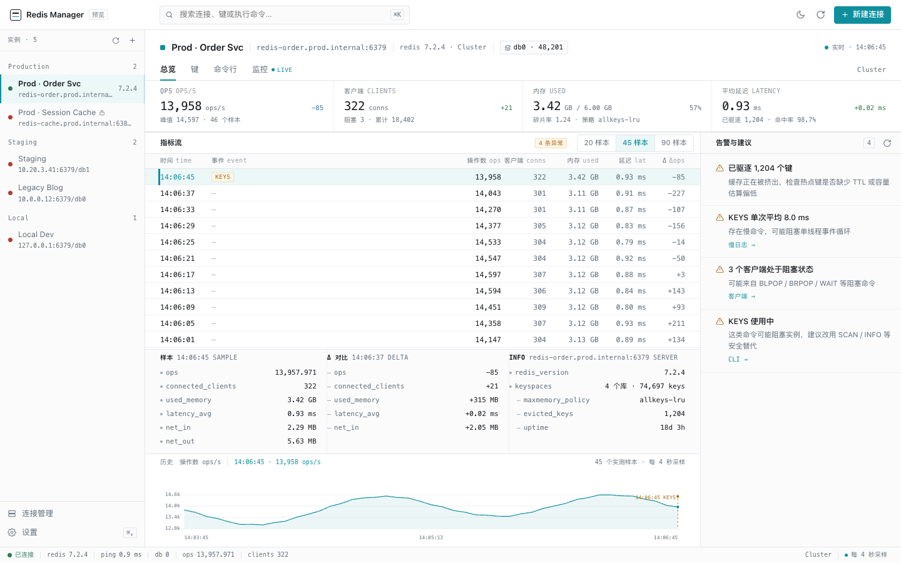

*界面按「协议分析台」组织：左侧按分组切换实例，右侧自上而下排布核心读数条、实时指标采样流、单样本详情与差值对比、历史趋势及可跳转的告警建议（截图使用内置演示数据）。*

## 功能特性

| 模块 | 已实现能力 |
| --- | --- |
| 连接管理 | 保存、编辑、克隆、删除、分组、7 色实例标识、连接测试与只读保护；支持 Standalone / Sentinel（多节点列表）/ Cluster、IPv6、ACL 用户名、密码与 TLS（含自签名跳过证书校验） |
| 凭据安全 | 默认采用本地 `0600` 密钥文件进行 `AES-256-GCM` 加密保存密码（避免无签名更新触发系统钥匙串重复弹窗），支持与系统钥匙串双向切换迁移 |
| 数据库切换 | 按 `(连接, DB)` 独立记忆并隔离客户端连接池；Cluster 模式固定使用 `db0` 并支持跨全部主节点遍历与聚合 |
| 总览与采样流 | QPS、客户端数、内存、延迟读数条；每 4 秒采样的指标流（支持 `↑` / `↓` 逐条检视、异常事件标记、相邻样本 `Δ` 对比）、趋势曲线与告警建议跳转 |
| 键浏览 | `SCAN` 游标分页（含 Cluster 全主节点扫描）、匹配模式、已扫键名过滤、冒号前缀分组、数据类型筛选；大键自动启用 `GETRANGE` / `HSCAN` / `SSCAN` / `XRANGE` 批次保护 |
| 值查看与预览 | 支持 String / Hash / List / Set / ZSet / Stream；String 提供原始、JSON、Hex、隔离 HTML 预览与 Markdown 预览，支持一键复制键值与超长字段原地展开 |
| 数据操作 | 支持新建键（String / Hash + TTL）、内联修改或持久化 TTL、String 编辑保存、Hash 字段新增/覆盖/删除、键二次确认删除；只读连接前后端统一拦截写删 |
| 命令行（CLI） | 多会话创建与关闭、历史命令翻阅、命令名 `Tab` 补全、子命令级只读保护（放行 `CONFIG GET` / `CLIENT LIST` 等查询）；自动拦截 `KEYS`、`MONITOR`、`SELECT` 等高危或污染连接命令 |
| 实时监控 | 命令吞吐与网络进出流量曲线、主从复制拓扑与延迟、服务器 `INFO` 键值、慢查询（`SLOWLOG`）与客户端连接列表 |
| 效率与更新 | `⌘K` 全局命令面板、全键盘快捷键、偏好设置持久化；签名发布包支持版本检查、更新日志展示、下载进度与 Ed25519 差分更新 |

远程连接加载时，键元数据按批次通过 pipeline 读取，重复的 Overview 请求自动合并，已建立的 Redis 客户端连接池按实例复用。后台默认每 4 秒采样一次指标；窗口隐藏或模态弹窗打开时自动暂停采样，刷新期间保留输入框草稿、焦点光标及未变化预览的阅读滚动位置。

## 界面预览

### 键空间浏览与内容预览

| 键浏览（前缀分组 · Hash 字段与底部写入） | String 键值（隔离 HTML 渲染预览） |
| --- | --- |
| 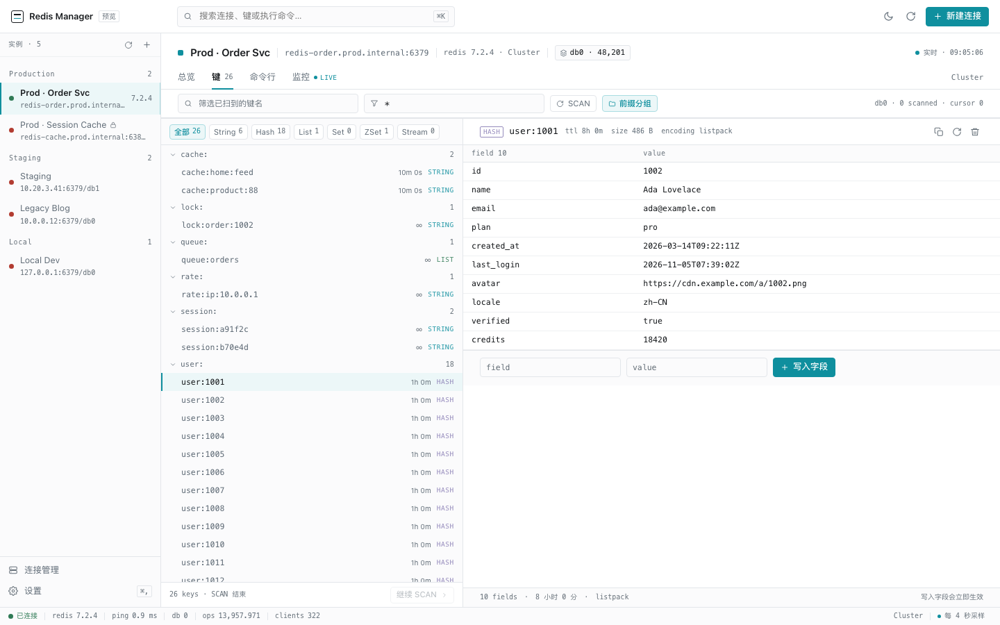 | 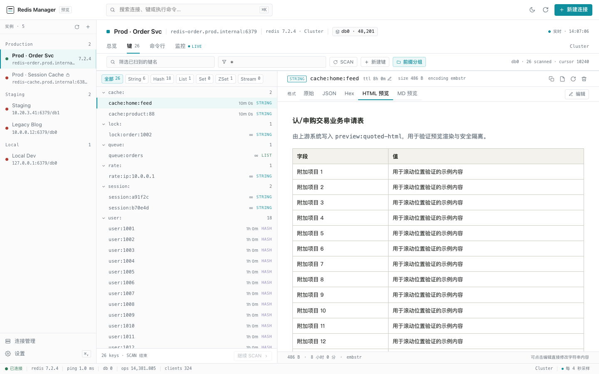 |

### 命令行与实时监控

| 多会话 CLI（只读保护与 `KEYS` 拦截） | 实时监控（吞吐曲线 · 复制拓扑 · 慢查询） |
| --- | --- |
| 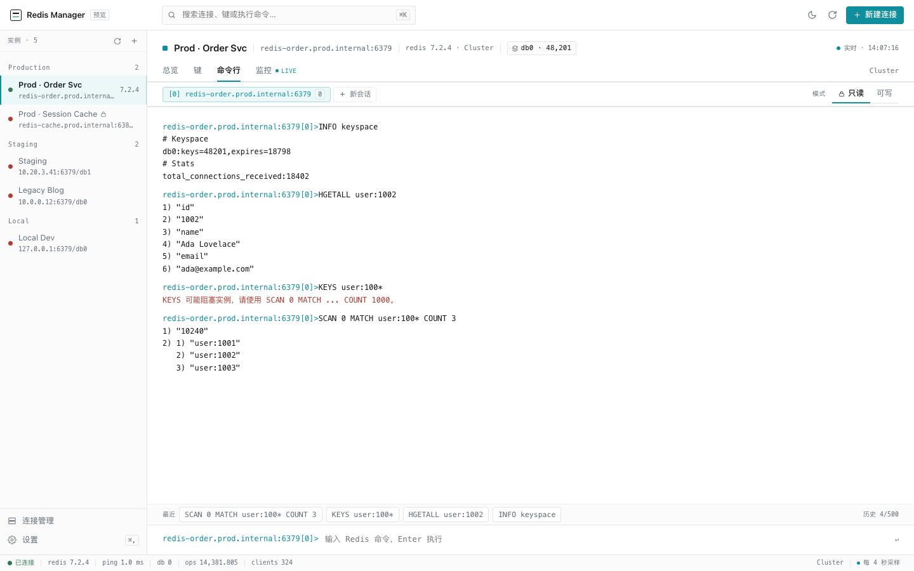 | 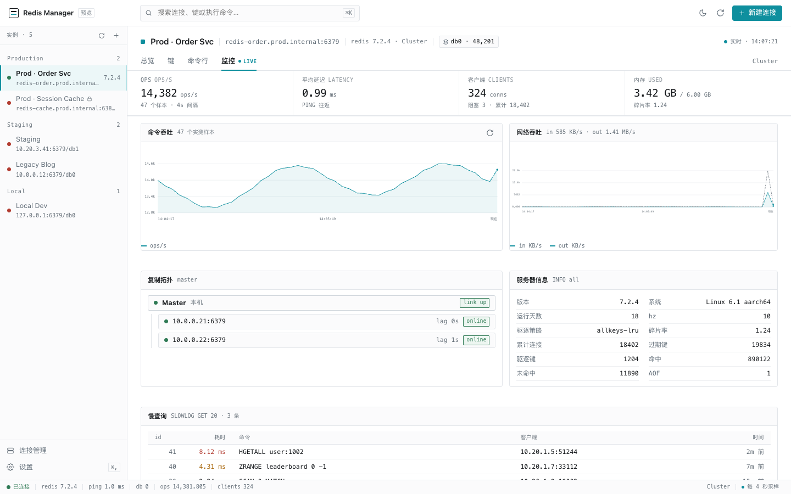 |

### 连接管理与连接配置

| 连接列表与本地加密凭据状态 | 新建 / 编辑连接（部署模式 · 标识色 · TLS） |
| --- | --- |
| 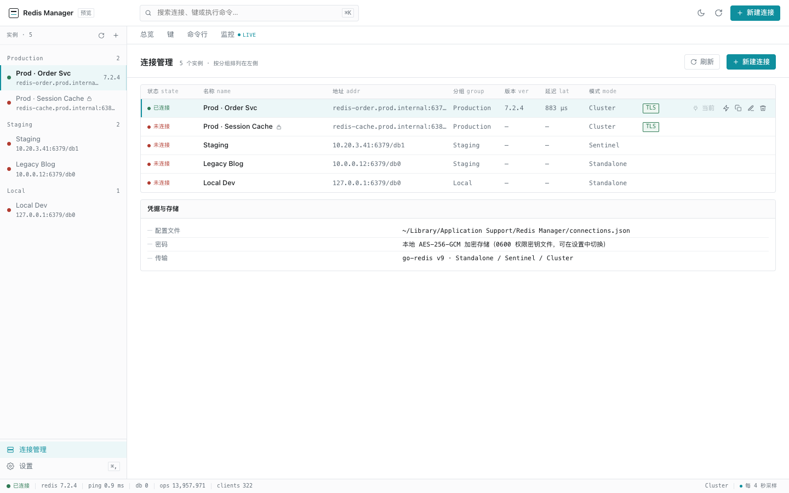 | 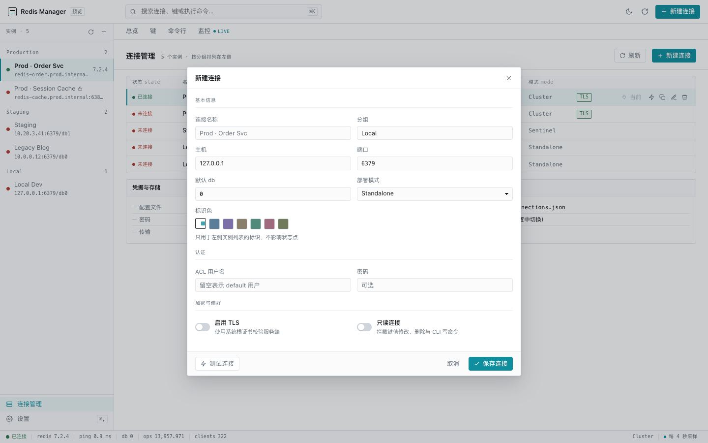 |

### 全局命令面板与偏好设置

| `⌘K` 命令面板（搜实例、搜键、切视图、跑命令） | 设置（配色切换 · SCAN 参数 · 密码存储方式） |
| --- | --- |
| 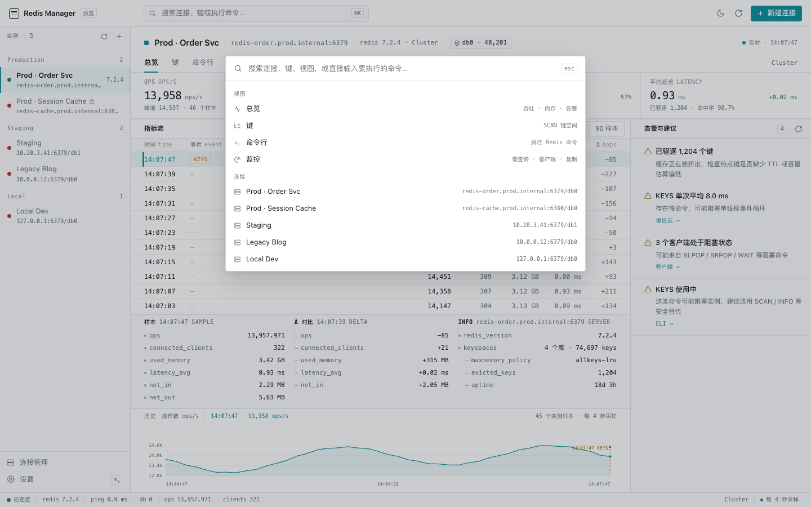 | 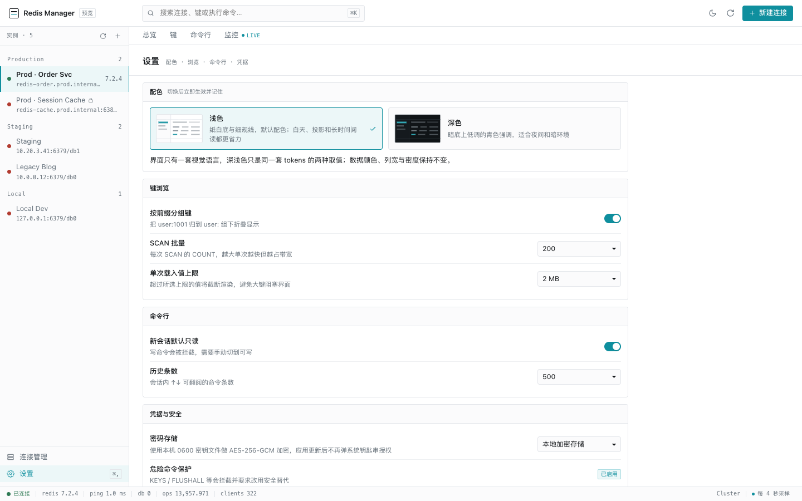 |

### 深色配色（Dark Scheme）

界面采用同一套设计语义与列宽密度，可通过顶栏右上角太阳 / 月亮图标或「设置 → 配色」一键切换深色模式：

| 总览（深色） | 键浏览（深色） |
| --- | --- |
| 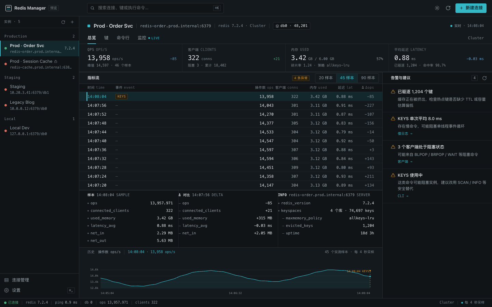 | 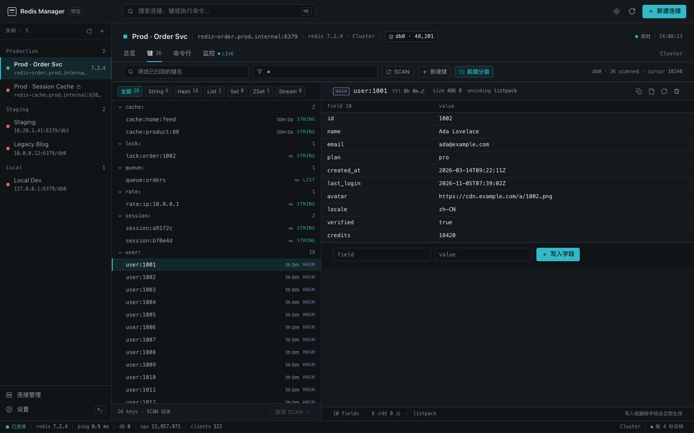 |

| 命令行（深色） | 监控（深色） |
| --- | --- |
| 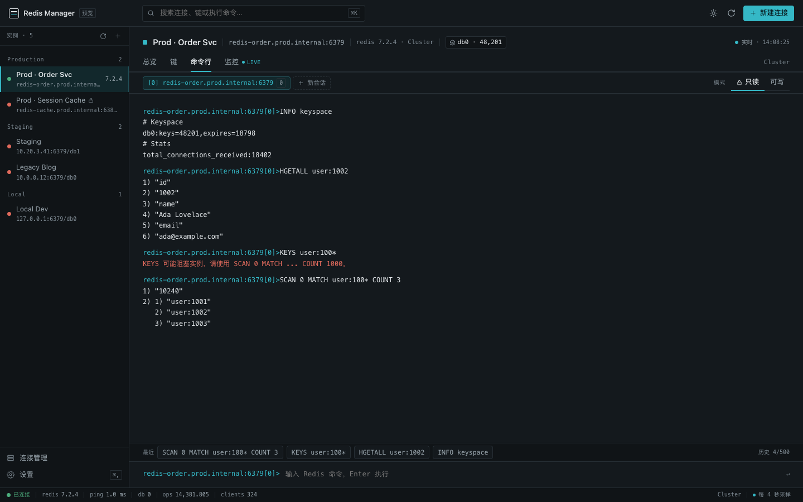 | 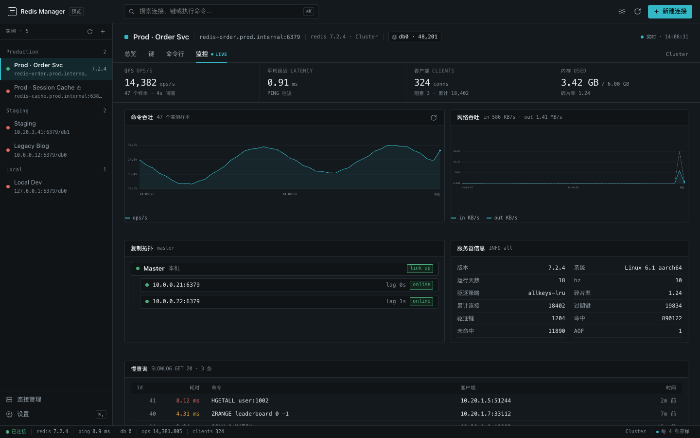 |

> 更多深色页面截图（连接管理、设置等）位于 [`docs/screenshots/`](docs/screenshots/)。

## 快速开始

### 环境要求

| 工具 | 要求或用途 |
| --- | --- |
| Go | `go.mod` 声明版本为 **1.27.3** |
| Bun | 安装前端依赖与执行项目脚本；本地验证版本为 1.2.16 |
| Node.js | 建议 **22.12+**，用于 Vite、构建辅助及浏览器回归脚本 |
| Redis | 本地或远程 Redis 实例（Standalone / Sentinel / Cluster） |
| Google Chrome / Chromium | 可选，仅运行浏览器回归测试与生成截图脚本时需要 |

MyGo CLI 和前端运行时随项目依赖自动安装，无需单独全局安装。

在仓库根目录执行：

```bash
bun install
bun run dev
```

`dev` 会同时启动 Vite 前端开发服务与 MyGo 桌面窗口，并加载 Go 后端服务绑定。

### 连接并浏览

1. 点击右上角「新建连接」，填写主机、端口、默认 DB 和部署模式，按需配置标识色、ACL 认证与 TLS。
2. 点击「测试连接」，确认连通后保存。
3. 在左侧实例栏选择目标实例，在实例标题栏切换数据库，进入「键」视图。
4. 使用 `*` 或 `user:*` 等匹配模式执行 `SCAN`，点击任意键查看详情；需要更多结果时点击底部「继续 SCAN」。

`SCAN` 默认 `COUNT` 为 200，可在设置中调整（最大 1000）。`COUNT` 是扫描批次提示，单次返回数量取决于键空间分布；前端单次会话最多保留 2000 个键。

### 纯浏览器预览界面（无需 Redis）

```bash
bun run dev:web
```

打开 [http://localhost:5173/?preview=1](http://localhost:5173/?preview=1)，即可使用内置演示数据体验全部视图与交互，无需启动 Redis 或 Go 服务。

也可以通过 URL 参数直接指定视图与配色，例如：
- 浅色键浏览：[http://localhost:5173/?preview=1&page=browser&scheme=light](http://localhost:5173/?preview=1&page=browser&scheme=light)
- 深色总览：[http://localhost:5173/?preview=1&page=overview&scheme=dark](http://localhost:5173/?preview=1&page=overview&scheme=dark)

`dev:web` 仅提供前端页面；连接真实 Redis 请使用 `bun run dev` 或打包后的桌面应用。

## HTML 与 Markdown 预览

选中 `String` 类型的键后，可在右侧值面板顶部切换五种显示格式：

| 格式 | 展示方式 |
| --- | --- |
| 原始 | 原样查看 Redis 返回的字符串内容 |
| JSON | 当值为合法 JSON 时自动显示并格式化缩进 |
| Hex | 查看字符串前 4096 个字符的十六进制与 ASCII 对照 |
| HTML 预览 | 在隔离沙箱中渲染 HTML 片段或完整文档，保留原有样式与表格排版 |
| MD 预览 | 渲染标题、段落、强调、链接、列表、引用、代码块、表格及分隔线 |

- **JSON 字符串自动解包**：若键值存为一层 JSON 字符串（如 `"<h1>标题</h1>\r\n<p>正文</p>"`），切换到 HTML / MD 预览时会先安全解开外层字符串包装；原始、JSON 和 Hex 视图仍展示原始存储内容，普通反斜杠路径不会被误转义。
- **安全隔离**：HTML 预览运行在 `sandbox=""` 隔离 `iframe` 内，禁止执行脚本和加载外部资源；`${fundName}` 等模板占位符按原文保留展示，不会执行模板求值。
- **状态保持**：后台指标刷新或手动重读同一键时会保留当前预览格式与滚动位置；切换键、实例或数据库时自动回到「原始」格式。

## 界面架构与设计语言

信息架构只有一条主轴：**左侧是实例导航，右侧标签页是当前实例内的视图**，连接管理与设置固定在侧栏底部：

```text
实例栏（分组 / 状态 / 版本）   实例标题栏（名称 · 地址 · 版本 · 模式 · 数据库 · 实时状态）
  ├─ 总览                     读数条 → 指标采样流 / 样本字段对比 / 历史趋势 + 告警与建议
  ├─ 键                       SCAN 与筛选栏 → 前缀分组键列表 / 值与元数据面板
  ├─ 命令行                   多会话标签、只读保护切换、历史记录与命令输入
  └─ 监控                     吞吐曲线、主从复制拓扑、服务器 INFO、慢查询、客户端
```

视觉上采用扁平的「协议分析台」风格：仅用 `1px` 细线划分版面，所有数值与标识符采用等宽字体（`tabular-nums`）按固定列对齐；青色强调色只用于表示「当前状态」（选中行、活动视图、主操作按钮、实时采样点与测量曲线）。完整视觉规范与设计 token 见 [DESIGN.md](DESIGN.md)，产品定位与原则见 [PRODUCT.md](PRODUCT.md)。

## 开发与回归检查

| 命令 | 用途 |
| --- | --- |
| `bun run dev` | 启动完整桌面开发环境（Vite + MyGo + Go 服务） |
| `bun run dev:web` | 仅启动前端 Vite 开发服务 |
| `bun run generate` | 根据 Go 服务接口重新生成 `src/mygo.ts` 绑定 |
| `bun run typecheck` | 运行 TypeScript 类型检查 |
| `bun run checks` | 运行 TypeScript 类型检查、`bun run test:state`、`go vet` 与 `go test` |
| `bun run build:web` | 类型检查并构建前端静态资源到 `dist/` |
| `bun run build` | 调用 MyGo 构建桌面应用 |
| `bun run test:previews` | 运行内容预览、CLI、焦点与草稿保留的浏览器回归测试 |
| `bun run test:state` | 运行异步乱序响应与实例 / 数据库 / 键切换状态回归测试 |
| `bun run test:release` | 运行发布流程与更新清单校验测试 |
| `bun run release:check` | CI 发布门禁：校验版本标签、签名密钥、`mygo.config.ts` 与 `CHANGELOG.md` |

浏览器回归测试会自动启动临时 Vite 服务与无头 Chrome，无需连接真实 Redis：

```bash
# 运行 Go 凭据加密与迁移单元测试
go test ./...

# 运行浏览器回归，并将预览验证截图输出到指定目录
node scripts/test-value-preview.mjs .shots/preview-fix

# 指定自定义 Chromium 可执行文件运行回归
CHROME_BIN="/path/to/chromium" bun run test:previews

# 重新生成全部界面截图（写入 docs/screenshots/）
node scripts/shoot-screens.mjs

# 按文件名关键字单独重拍某张截图（例如只拍 overview 或 browser-value-preview）
node scripts/shoot-screens.mjs 4173 overview
```

> 注意：`src/mygo.ts` 为自动生成文件，修改 Go 服务方法签名后请执行 `bun run generate`，切勿手动编辑该文件。

## macOS 本地构建

```bash
# 构建当前机器架构的 .app 与 .dmg
bun run package:mac

# 构建 Intel + Apple Silicon 通用安装包
bun run package:mac:universal

# 仅生成 .app 应用包，跳过 DMG 制作
./scripts/build.sh mac --skip-dmg
```

Apple Silicon 默认构建产物路径：

```text
build/darwin-arm64/
├── redis-manager.app
└── redis-manager-0.3.0-arm64.dmg
```

应用版本号统一读取自 [mygo.config.ts](mygo.config.ts)，桌面图标由 [resources/icon.png](resources/icon.png) 自动转换生成。构建脚本常用参数：

| 参数 | 用途 |
| --- | --- |
| `--arch arm64\|amd64\|universal` | 指定 macOS 目标架构 |
| `--skip-dmg` | 跳过制作 DMG（构建环境不支持创建磁盘映像时也会自动跳过） |
| `--no-clean` | 保留已有 `build/` 与 `dist/` 目录 |
| `--no-checks` | 跳过独立检查步骤（前端构建阶段仍会执行类型检查） |
| `--sign <identity>` | 指定 macOS 代码签名身份 |

## GitHub 发布与自动更新

仓库配置了版本标签触发的 GitHub Actions 工作流：自动编译 **macOS 通用版（Universal DMG）** 与 **Windows x64（NSIS 安装程序）**，生成并校验 Ed25519 签名更新包后统一发布正式 Release。

1. 在仓库 Actions 配置公钥变量 `MYGO_UPDATER_PUBLIC_KEY` 与私钥机密 `MYGO_UPDATER_PRIVATE_KEY`。
2. 更新 [mygo.config.ts](mygo.config.ts) 中的 `version` 并在 [CHANGELOG.md](CHANGELOG.md) 补充对应版本说明。
3. 推送匹配的 `vX.Y.Z` 标签触发构建与发布。

带更新配置的正式构建支持新版本提醒与「设置 → 关于 → 检查更新」，优先下载可用的 `.delta` 差分包，差分不可用时自动回退完整更新包。密钥初始化、发布步骤与校验说明详见 [发布与应用更新指南](docs/releases.md)。

## 快捷键

| 快捷键 | 操作 |
| --- | --- |
| `⌘K` | 打开全局命令面板（搜索连接、键、视图或直接执行命令） |
| `⌘,` | 打开设置 |
| `⌘1` / `⌘2` / `⌘3` / `⌘4` | 切换当前实例视图：总览 / 键 / 命令行 / 监控 |
| `⌘T` | 在命令行新建会话 |
| `⌘R` | 立即刷新采样指标 |
| `⌘L` | 清空当前命令行输出 |
| `↑` / `↓` | 在命令行翻阅历史命令，或在总览采样流 / 键列表中移动选中行 |
| `Tab` | 在命令行输入框补全 Redis 命令名 |
| `Esc` | 关闭命令面板、菜单、确认框或连接编辑器 |

在非 macOS 平台上，上述组合键同样支持使用 `Ctrl` 触发。

## 本地数据存储

- **连接配置**：macOS 保存在 `~/Library/Application Support/Redis Manager/connections.json`（文件权限 `0600`）。
- **连接密码**：默认使用同目录下 `0600` 权限的本地密钥文件（`credential.key`）进行 `AES-256-GCM` 加密存储，避免无 Apple 开发者证书签名时每次更新后重复弹出系统钥匙串授权提示；也可在「设置 → 凭据与安全」中随时切换为系统钥匙串存储（偏好记录于 `preferences.json`）。
- **界面偏好**：配色方案、`SCAN` 批量、值载入上限及 CLI 默认只读等偏好保存在 WebView 的 `localStorage`。
- **CLI 会话与历史**：仅保存在当次运行内存中，重启应用后自动清空。

删除已保存连接会同步清理本地配置项与对应密码凭据；在键浏览中执行删除则会直接删除所连 Redis 实例中的目标键。

## 当前限制

- **集合类型可视化写入**：图形界面目前已覆盖新建键（String / Hash）、TTL 修改/持久化、String 编辑、Hash 字段写入与删除以及键删除；List / Set / ZSet / Stream 的元素级写入仍建议通过内置 CLI 完成。
- **只读模式定位**：连接级只读与 CLI 只读模式通过客户端与本地 Go 服务侧拦截写命令，旨在防范日常误操作；生产环境的严格权限边界仍建议配合服务端 Redis ACL 账号控制。
- **大值保护上限**：为避免阻塞单线程 Redis 与前端界面，服务端对 String 单次最多加载前 4 MiB（`GETRANGE`），Hash / Set / List / ZSet 最多加载前 2,000 项（大 Hash / Set 自动改走 `HSCAN` / `SSCAN`），Stream 最多读取 500 条消息；前端渲染上限可在设置中按需调整（256 KB ～ 32 MB）。
- **后续规划**：SSH 隧道（Bastion）、mTLS 客户端证书及更多集合类型的图形化编辑属于后续迭代方向。

## 项目结构

| 路径 | 职责说明 |
| --- | --- |
| `main.go` / `types.go` | MyGo 应用入口、服务生命周期与前后端共享数据结构定义 |
| `connections.go` / `keys.go` / `cli.go` | 按 `(连接, DB)` 隔离的 Redis 客户端池、大键保护读写、Cluster 遍历与子命令级 CLI 执行 |
| `metrics.go` / `parser.go` | 单机与 Cluster 多主节点指标聚合、慢查询、客户端及 `INFO` 协议文本解析 |
| `credentials.go` | 本地 `AES-256-GCM` 密钥管理、系统钥匙串适配与凭据双向迁移 |
| `app_updates.go` | 应用版本、配置目录信息与 MyGo 自动更新检查入口 |
| `src/app.ts` | 前端壳层渲染、DOM 状态保留、全局事件、快捷键与对话框交互 |
| `src/core/` | 全局状态存储、Go API 封装、格式化与安全预览渲染、SVG 趋势图 |
| `src/views/` / `src/ui/` | 总览、键浏览、CLI、监控、连接、设置视图及通用界面组件 |
| `src/theme/` / `src/styles/` | 浅色 / 深色方案、偏好持久化与设计系统样式 token |
| `src/mygo.ts` | 自动生成的 Go 服务前端类型绑定 |
| `resources/icon.png` | 应用图标源文件 |
| `scripts/` | 打包构建、演示数据桩、无头浏览器回归测试与自动截图脚本 |
| `docs/` | 发布指南、界面截图与历史设计演进文档 |

## 相关文档

- [产品定义与原则](PRODUCT.md)
- [设计系统与视觉规范](DESIGN.md)
- [版本更新日志](CHANGELOG.md)
- [GitHub 发布与自动更新指南](docs/releases.md)
- [文档与历史设计索引](docs/README.md)
