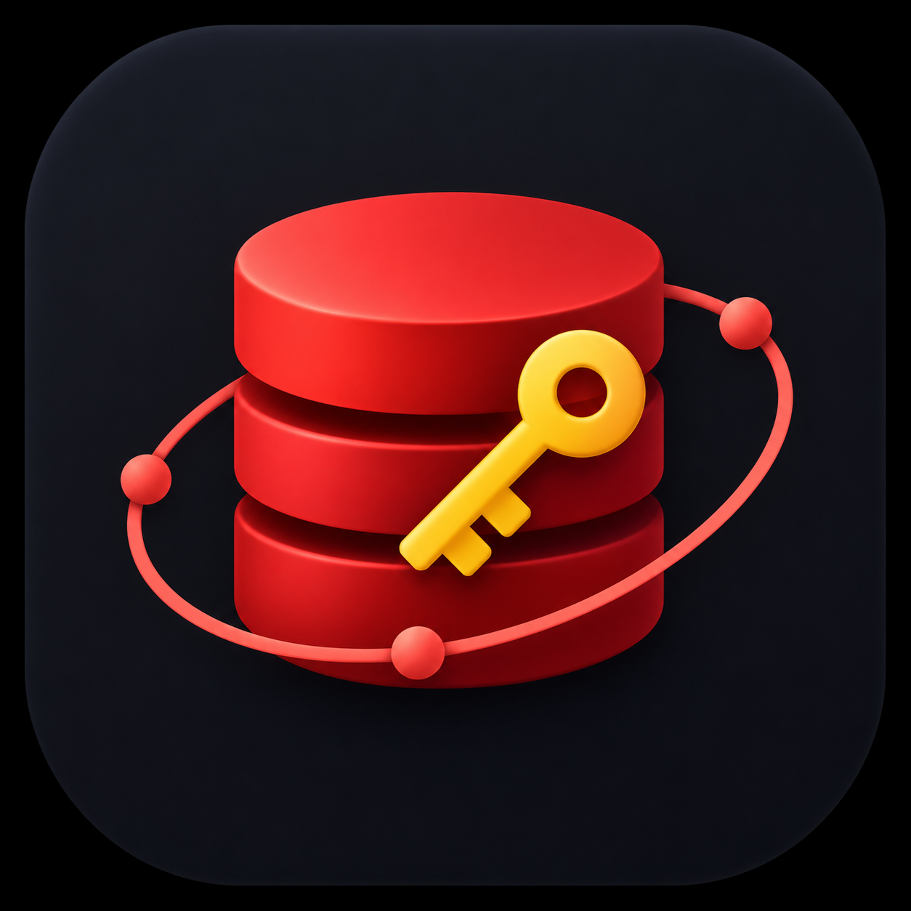
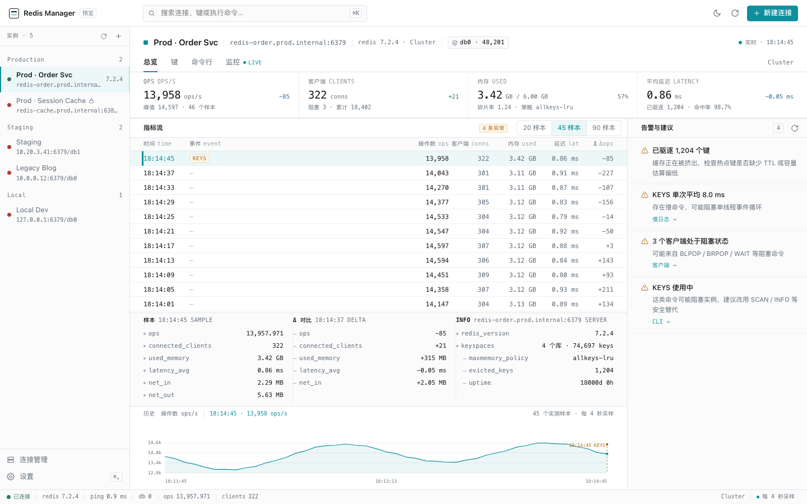
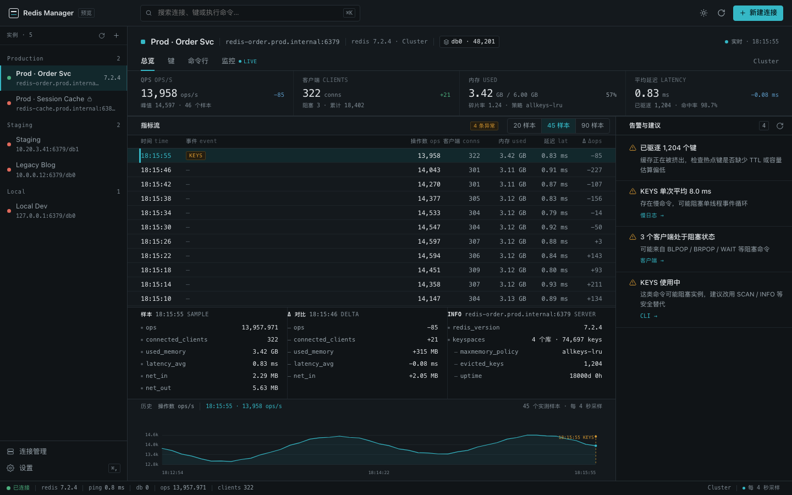

<p align="center">
  
</p>

# Redis Manager

一个基于 **Go + MyGo + TypeScript** 的 Redis 桌面管理工具，用于管理连接、浏览键值、执行命令和查看服务器状态。

支持 String、Hash、List、Set、ZSet、Stream 的类型化展示，以及 HTML / Markdown 内容预览。界面是一套按「协议分析台」组织的工作区：实例在左，读数、采样流、字段详情与历史趋势自上而下排布，浅色 / 深色两种配色，默认浅色。

当前版本为 `0.1.0`，已验证 macOS Apple Silicon 应用构建。





*截图使用演示数据；实际运行时显示所连接 Redis 实例的数据。*

## 功能

| 模块 | 已实现能力 |
| --- | --- |
| 连接管理 | 保存、编辑、删除、分组、测试连接；Standalone / Sentinel / Cluster 连接配置；ACL 用户名、密码与 TLS |
| 数据库切换 | 按连接记住当前 DB；Cluster 固定使用 DB 0 |
| 键浏览 | SCAN 游标分页、匹配模式、前缀分组、类型筛选；查看类型、TTL、大小及编码 |
| 值查看 | String / Hash / List / Set / ZSet / Stream；String 支持原始、JSON、Hex、HTML 和 Markdown |
| 数据操作 | Hash 字段新增与覆盖、键删除；其他写操作可通过 CLI 执行 |
| CLI | 多会话、命令历史、命令名补全、只读模式；拦截 `KEYS` 并提示使用 `SCAN` |
| 总览与监控 | 操作速率、客户端数、内存、网络、键空间、命令统计、INFO、慢查询及主从信息 |
| 界面 | 实例优先的导航、指标流式总览、⌘K 命令面板、快捷键、浅色 / 深色配色（默认浅色）、偏好记忆 |
| 应用更新 | 配置签名密钥的发布构建支持版本通知、手动检查、下载进度及差分更新 |

远程连接加载时，键元数据按批次通过 pipeline 读取，重复的 Overview 请求会合并，已建立的 Redis 客户端会复用。
后台默认每 4 秒更新指标；窗口隐藏或相关弹窗打开时暂停采样。浏览值时，指标更新会保留显示格式和未变化预览的滚动位置。

## 快速开始

### 环境

| 工具 | 要求或用途 |
| --- | --- |
| Go | `go.mod` 声明的版本为 **1.27.3** |
| Bun | 安装前端依赖及执行项目脚本；本地验证版本为 1.2.16 |
| Node.js | 建议 **22.12+**，用于 Vite、构建辅助及浏览器回归脚本 |
| Redis | 使用你已有的本地或远程实例 |
| Google Chrome / Chromium | 可选，仅浏览器回归和截图脚本需要 |

MyGo CLI 和前端运行时由项目依赖安装，无需单独全局安装。

在仓库根目录执行：

```bash
bun install
bun run dev
```

`dev` 会启动 Vite 开发服务与 MyGo 桌面窗口，并加载 Go 服务绑定。

### 连接并浏览

1. 点击「新建连接」，填写主机、端口、默认 DB 和部署模式，按需设置认证与 TLS。
2. 点击「测试连接」，确认可连接后保存。
3. 在左侧选择实例，在实例标题栏切换数据库，进入「键」。
4. 使用 `*` 或 `user:*` 等匹配模式执行 SCAN，点击键查看值；需要更多结果时点击「继续 SCAN」。

SCAN 默认 `COUNT` 为 200，可在设置中调整，最大为 1000。`COUNT` 是扫描提示，实际返回数量可能不同；前端最多保留 2000 个键。

### 只预览界面

```bash
bun run dev:web
```

打开 [本地演示页面](http://localhost:5173/?preview=1)，可使用内置假数据体验页面和交互，无需 Redis。

也可以指定页面与配色，例如 [浅色键浏览](http://localhost:5173/?preview=1&page=browser&scheme=light)。
`dev:web` 本身只提供前端页面；连接真实 Redis 请使用 `bun run dev` 或打包后的桌面应用。

## HTML 与 Markdown 预览

选中 String 类型的键后，在值面板顶部切换显示格式：

| 格式 | 展示方式 |
| --- | --- |
| 原始 | 查看 Redis 返回的字符串内容 |
| JSON | 对合法 JSON 进行格式化展示 |
| Hex | 查看字符串开头内容的十六进制与字符对照 |
| HTML 预览 | 渲染 HTML 片段或完整文档，保留文档自身的样式与表格排版 |
| MD 预览 | 渲染标题、段落、强调、链接、列表、引用、代码块、表格及分隔线 |

如果值保存为 JSON 字符串，例如 `"<h1>标题</h1>\r\n<p>正文</p>"`，HTML / MD 预览会先解开一层合法的字符串包装。
原始、JSON 和 Hex 仍基于保存的内容展示，普通字符串里的反斜杠不会被盲目替换。

HTML 在隔离的 iframe 内预览，脚本及外部资源被禁用；依赖外部 CSS、图片或 JavaScript 的页面可能无法完整呈现。
`${fundName}` 等模板变量按原文显示，不会执行模板逻辑或填充业务数据。Markdown 支持常用语法，不是完整的 Markdown 编辑器。

后台刷新和同一键的手动重读会保留当前格式；切换键、连接或数据库时回到原始格式。

## 界面

信息架构只有一条轴：**实例是导航，页面是实例内的视图**。

```
实例栏（分组 / 状态 / 版本）   实例标题栏（地址 · 版本 · 模式 · 数据库 · 实时）
  ├─ 总览   读数条 → 指标流 / 采样详情 / 历史趋势 + 告警与建议
  ├─ 键     扫描与筛选 → 键列表 / 值面板（元信息以字段呈现）
  ├─ 命令行 多会话、只读切换、命令历史
  └─ 监控   趋势、复制拓扑、INFO、慢查询、客户端
```

视觉上是「协议分析台」：只用 1px 细线分隔版面，数据用等宽字体按固定列对齐，青色只标记「当前」——选中的行、活动标签、主操作与实时状态。

配色只有浅色 / 深色两套，**默认浅色**，通过顶栏右侧的太阳 / 月亮按钮或「设置 → 配色」切换，选择保存在本地。
设计取舍与 token 见 [设计系统](DESIGN.md)。

## 开发与检查

| 命令 | 用途 |
| --- | --- |
| `bun run dev` | 启动完整桌面开发环境 |
| `bun run dev:web` | 启动前端开发服务 |
| `bun run generate` | 从 Go 服务生成 TypeScript 绑定 |
| `bun run typecheck` | TypeScript 类型检查 |
| `bun run checks` | TypeScript 类型检查与 `go vet ./...` |
| `bun run build:web` | 检查并构建前端到 `dist/` |
| `bun run test:previews` | 运行预览、CLI 和编辑状态的浏览器回归 |
| `bun run test:state` | 运行异步请求与连接、数据库、键切换的状态回归 |

浏览器回归会启动临时 Vite 服务和独立的无界面 Chrome，使用合成数据验证内容预览、轮询期间的草稿与焦点保留、连接编辑、命令历史及删除确认的目标。状态回归通过内存服务模拟乱序响应，验证旧读取、扫描、写入或保存结果不会覆盖新目标；两类测试均无需连接 Redis。

```bash
# 运行回归，同时保存 HTML / Markdown 截图
node scripts/test-value-preview.mjs .shots/preview-fix

# 使用其他 Chromium 可执行文件
CHROME_BIN="/path/to/chromium" bun run test:previews

# 重新生成界面截图，写入 docs/screenshots/
node scripts/shoot-screens.mjs
```

`src/mygo.ts` 是生成文件。修改 Go 服务接口后运行 `bun run generate`，不要直接修改绑定代码。

## macOS 构建

```bash
# 当前机器架构的 .app 与 .dmg
bun run package:mac

# Intel / Apple Silicon 通用构建
bun run package:mac:universal

# 仅生成应用，不制作磁盘映像
./scripts/build.sh mac --skip-dmg
```

Apple Silicon 构建产物位于：

```text
build/darwin-arm64/
├── redis-manager.app
└── redis-manager-0.1.0-arm64.dmg
```

版本来自 [mygo.config.ts](mygo.config.ts)。应用图标使用 [resources/icon.png](resources/icon.png)，MyGo 会自动将它转换为桌面图标资源。
构建完成后可直接打开 `.app`，或将其复制到「应用程序」。

构建脚本默认清理 `build/` 与 `dist/`，随后运行检查、构建前端、编译并打包应用。常用参数如下：

| 参数 | 用途 |
| --- | --- |
| `--arch arm64\|amd64\|universal` | 指定 macOS 架构 |
| `--skip-dmg` | 跳过 DMG；环境无法创建磁盘映像时也会自动跳过 |
| `--no-clean` | 保留已有构建目录 |
| `--no-checks` | 跳过脚本的独立检查步骤，前端构建仍会执行类型检查 |
| `--sign <identity>` | 指定 macOS 签名身份 |

当前已验证 macOS arm64 构建；通用构建是脚本提供的选项，其他架构及平台尚未完成运行验收。
`bun run package:web` 可调用 MyGo 的 Web 构建目标，该目标的 Redis 连接能力尚未验证。

## GitHub 发布与自动更新

仓库提供版本标签触发的 GitHub Actions：构建 macOS 通用版和 Windows x64 安装包，校验两端的签名更新包后统一发布 Release。
先配置公钥变量 `MYGO_UPDATER_PUBLIC_KEY` 与私钥 Secret `MYGO_UPDATER_PRIVATE_KEY`，再推送与 `mygo.config.ts` 版本对应的 `vX.Y.Z` 标签。

带更新功能的正式应用会显示新版本提示，并优先使用可用的差分包；无法应用差分时回退完整包。现有旧应用需要手动安装一次带更新功能的版本。
密钥初始化、发布步骤、产物及验证边界见 [发布与应用更新指南](docs/releases.md)。

## 快捷键

| 快捷键 | 操作 |
| --- | --- |
| `⌘K` | 打开命令面板 |
| `⌘,` | 打开设置 |
| `⌘T` | 新建 CLI 会话 |
| `⌘R` | 刷新总览指标 |
| `⌘L` | 清空当前 CLI 输出 |
| `⌘1` / `⌘2` / `⌘3` / `⌘4` | 总览 / 键浏览 / CLI / 监控 |
| `↑` / `↓` | 在 CLI 输入框中切换历史命令 |
| `Tab` | 在 CLI 输入框中补全命令名 |
| `Esc` | 关闭命令面板、菜单或弹窗 |

代码同时识别 `Ctrl` 作为组合键修饰键。

## 数据存储

- **连接配置**：macOS 路径为 `~/Library/Application Support/Redis Manager/connections.json`。
- **密码**：优先使用 MyGo 系统凭据存储；不可用时回退到权限为 `0600` 的连接配置文件。
- **界面偏好**：配色、SCAN 参数和 CLI 默认只读等设置保存在 WebView 的 `localStorage`。
- **CLI 会话与历史**：保存在本次应用运行的内存中，重启后不会恢复。

删除已保存连接会删除对应的本地配置和密码凭据；键删除则会操作当前连接的 Redis 数据。

## 当前限制

- **写入范围**：界面支持 Hash 字段写入和键删除，尚未提供所有数据类型的完整编辑器。
- **只读模式**：CLI 通过内置命令列表拦截部分写命令；它不是完整的权限控制，也不约束界面的 Hash 写入和键删除。需要限制服务器写入时，应使用 Redis ACL。`KEYS` 始终被 CLI 拦截。
- **大值读取**：设置中的值上限主要影响前端渲染。String、Hash、Set、Stream 仍可能从服务器完整读取；List / ZSet 最多读取前 5000 项。原始 / HTML / MD 最多渲染 200,000 个字符，Hex 使用前 4096 个源字符，JSON 格式化结果没有同样的截断处理。
- **Cluster 浏览**：已有 Cluster 连接路径，但 SCAN 和指标尚未实现逐主节点遍历与全局聚合，不能将结果视为整个集群的完整数据。
- **功能阶段**：SSH 隧道、应用锁屏及更完整的类型编辑等仍属于后续功能；历史设计文档中的功能清单可能包含这些规划。

## 项目结构

| 路径 | 作用 |
| --- | --- |
| `main.go` | MyGo 入口、Redis 服务、连接与凭据管理 |
| `src/app.ts` | 渲染、事件、快捷键及连接编辑交互 |
| `src/core/` | 状态、Go API 封装、格式与预览渲染、图表 |
| `src/views/` / `src/ui/` | 各页面与共享界面组件 |
| `src/theme/` / `src/styles/` | 配色方案、偏好与样式 token |
| `src/mygo.ts` | 自动生成的 Go 服务绑定 |
| `resources/icon.png` | 应用图标 |
| `scripts/` | 构建、演示数据、浏览器回归及截图工具 |
| `docs/` | 设计说明、截图与历史记录 |
| `prototype/` | 早期静态界面原型，不参与应用构建 |

技术栈：Go、MyGo 0.7.4、go-redis v9、TypeScript、Vite；前端采用原生 DOM 渲染。

文档入口：[设计系统](DESIGN.md) · [文档索引](docs/README.md) · [早期 UI 设计说明](docs/ui-prototype.md) · [历史风格对比](docs/styles.md)
