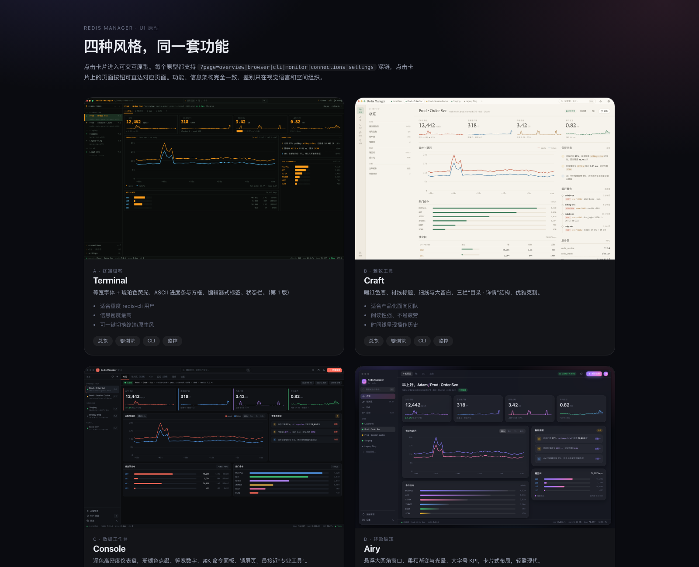
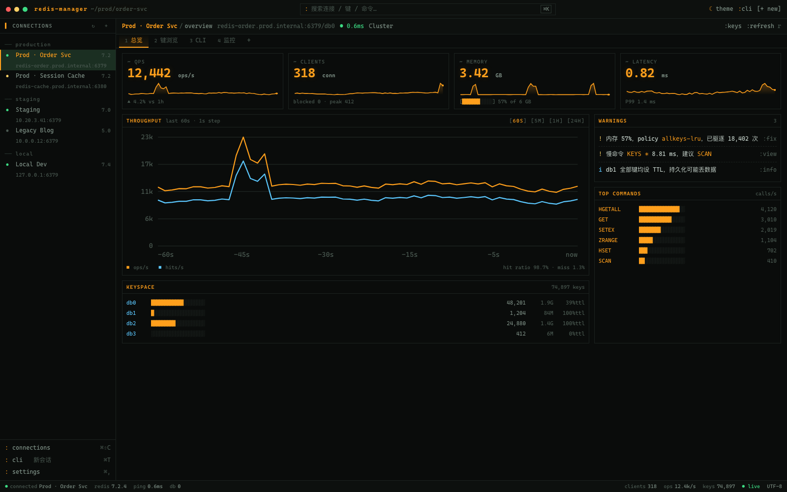
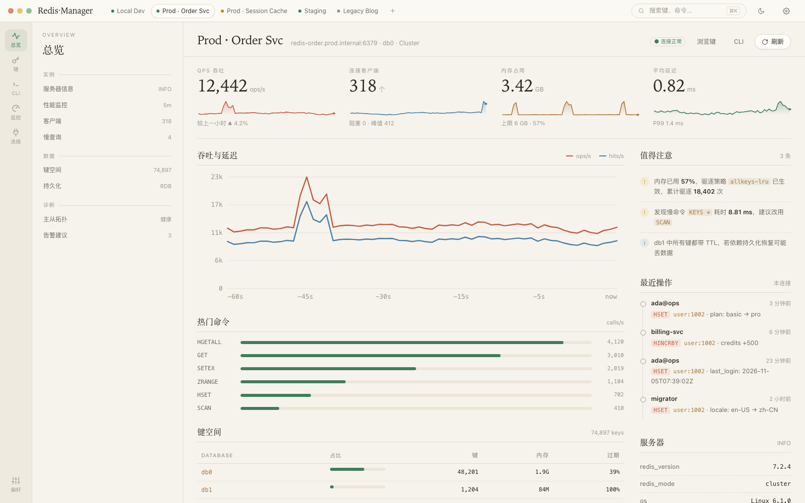
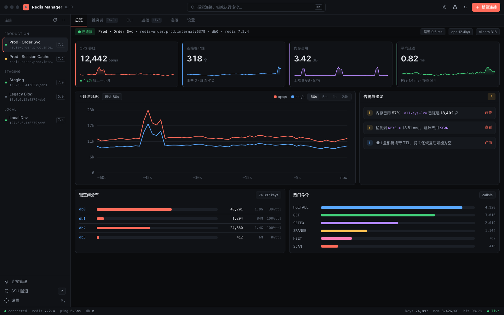
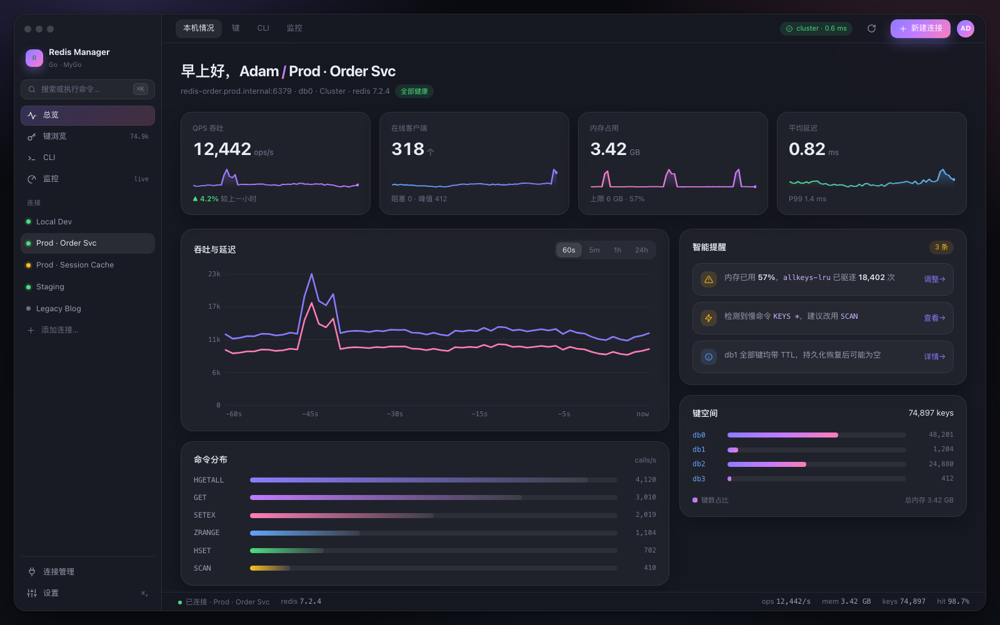

# 四套风格原型对比

> 同一个产品（Redis 管理器）、同一套功能与数据，用四种截然不同的视觉语言和空间组织方式呈现。
> 入口：[`../prototype/styles/index.html`](../prototype/styles/index.html)（风格选择页）



四套原型都是**可交互**的：页面切换、连接切换、主题切换、分段控件/开关/筛选 chip、图表 hover 十字线，Console 与 Airy 还有 **⌘K 命令面板**，Console 额外有**锁屏页**。每个页面都支持 `?page=` 深链。

| 风格 | 文件 | 默认主题 | 一句话 |
|---|---|---|---|
| A · Terminal | `styles/terminal.html` | 深色（琥珀） | 终端极客，等宽字体与 ASCII 符号 |
| B · Craft | `styles/craft.html` | 浅色（暖纸） | 雅致工具，衬线标题、细线、大留白 |
| C · Console | `styles/console.html` | 深色（珊瑚） | 数据工作台，高密度仪表盘 + 命令面板 |
| D · Airy | `styles/airy.html` | 深色（紫粉渐变） | 轻盈玻璃，悬浮大圆角窗口与渐变 |

统一交互约定（四套一致）：`?page=overview|browser|cli|monitor|connections|settings`，点击标签/侧栏切换，`data-tab` / `data-conn` / `data-action` 控制。

---

## A · Terminal — 终端极客风



```html
terminal.html?page=overview | browser | cli | monitor | connections | settings
```

| | |
|---|---|
| **视觉** | 全局等宽字体；黑底 + 琥珀色 `#ff9f1c` 荧光主色 + 青 `#5cc8ff` / 绿 `#3ddc84` 辅助；方框 `[ ]`、`─` 分隔线、`█░` ASCII 进度条；0 圆角 |
| **结构** | 编辑器式：左侧连接列表 → 面包屑 `Prod · Order Svc / keys / user:1002` → 文件页签 → 状态栏（conftected · redis 7.2.4 · ping · db · keys · live） |
| **独有元素** | `:command` 风格的可点击动作（`:cli` `:refresh` `:fix`）、ASCII 条形命令分布、`# 分组` 设置行 |
| **优点** | 信息密度最高；对 redis-cli 用户没有任何学习成本；纯 CSS，最容易由 MyGo 原生 UI 或终端组件复刻 |
| **代价** | 对非工程用户不友好；中文在等宽字体下排版略紧凑；视觉偏“工具”不偏“产品” |
| **适合** | 开发者自用 / 团队内部工具 / 内置到 CI、容器环境里 |

---

## B · Craft — 雅致工具风



```html
craft.html?page=overview | browser | cli | monitor | connections | settings
```

| | |
|---|---|
| **视觉** | 暖纸色 `#f6f3ec` / 墨绿 `#3f7d5b` / 陶土 `#c25c43`，衬线标题（Iowan Old Style / 宋体），1px 细线分隔，大留白，字形层级清晰；深色版为“墨绿夜读” |
| **结构** | 三栏：导航 rails（64px）→ **目录**（每组带“目录式”索引与说明）→ 内容；详情页是文档式排版，标题 + 小节 + 要点 |
| **独有元素** | KPI 用衬线大字号（类似杂志数据页）；**操作时间线**（谁在什么时候改了什么）；命令分布用绿色胶囊条 |
| **优点** | 阅读性最好、长时间看不累；适合写文档、做产品介绍；浅色是默认姿态，摆出来最“体面” |
| **代价** | 同等窗口下信息量比 A/C 少；衬线字体依赖系统，跨平台需要打包字体 |
| **适合** | 面向公司/团队交付的正式产品；客户演示 |

---

## C · Console — 数据工作台风



```html
console.html?page=overview | browser | cli | monitor
console.html?page=overview&palette=1   # ⌘K 命令面板
console.html?page=overview&lock=1      # 锁屏
```

| | |
|---|---|
| **视觉** | 深色高密度仪表盘：`#0b0c0e` 底 + 珊瑚 `#ff6b5a` 点缀，等宽数字 `tabular-nums`，6–8px 圆角，4 色类型标签 |
| **结构** | 顶栏（品牌 + ⌘K 搜索 + 操作）→ 侧栏（连接，带 `ver` 徽章）→ 页签 → **上下文条**（连接状态 / 延迟 / ops / clients）→ 内容 → 状态栏 |
| **独有元素** | **⌘K 命令面板**（键盘优先，模糊搜索连接/键/命令）；**锁屏页**（保护生产环境凭据，支持 Touch ID）；上下文条常驻关键指标 |
| **优点** | 一屏信息量最大；键盘流；最像“专业 DBA 工具”（类似 TablePlus / RedisInsight 的进阶版） |
| **代价** | 视觉冲击强但偏冷；键盘优先需要引导 |
| **适合** | 后端/DBA 日常、生产环境运维 |

---

## D · Airy — 轻盈玻璃风



```html
airy.html?page=overview | browser | cli | monitor | connections | settings
airy.html?page=overview&palette=1
```

| | |
|---|---|
| **视觉** | 桌面壁纸 + 悬浮大圆角窗口（20px），毛玻璃侧栏，紫→粉渐变 `#8b7cff → #ff7eb6` 作为品牌色，柔和光晕与大阴影，卡片 18–20px 圆角 |
| **结构** | 单窗口：左侧品牌栏 + 导航 + 连接，右侧“问候语式”标题（`早上好，Adam / Prod · Order Svc`）+ 大字号 KPI 卡片 + 双栏内容 |
| **独有元素** | 渐变 sparkline、渐变进度条、圆角胶囊标签、⌘K 玻璃面板、`全部健康` 胶囊状态 |
| **优点** | 第一眼最友好，最适合面向普通开发者的商业产品；视觉记忆点强 |
| **代价** | 毛玻璃/阴影有 GPU 开销（在 MyGo 原生 UI 里需要自绘或降级）；深色渐变容易显得“花” |
| **适合** | 面向全行业开发者的独立产品 / 有品牌诉求的 SaaS 客户端 |

---

## 横向对比

| 维度 | A Terminal | B Craft | C Console | D Airy |
|---|---|---|---|---|
| 信息密度 | ★★★★★ | ★★★ | ★★★★★ | ★★★☆ |
| 第一眼友好度 | ★★ | ★★★★ | ★★★☆ | ★★★★★ |
| 长时间使用舒适度 | ★★★★ | ★★★★★ | ★★★★ | ★★★★ |
| 实现成本（Web） | ★★★★★ 低 | ★★★★ 低 | ★★★★ 低 | ★★★ 中（毛玻璃/渐变） |
| 实现成本（MyGo 原生 UI） | ★★★★★ 最容易 | ★★★ | ★★★★ | ★★（阴影/模糊需自绘） |
| 键盘效率 | ★★★★ | ★★★ | ★★★★★（⌘K） | ★★★★（⌘K） |
| 差异化 | 终端情怀 | 质感 | 专业 | 亲和 |

## 建议

1. **默认风格选 C 或 D，A/B 作为可切换主题**：它们共用同一套“信息架构”与 Go 服务层，差异全部在 CSS token 与少量布局参数上，切换主题几乎是免费的（原型里 B 可一键切深色，证明这一点）。
2. 如果产品主要给**后端/运维**：C 最稳（密集信息 + 命令面板 + 只读/锁屏这些安全设计它承载得最好）。
3. 如果产品要**对外发布**：D 的品牌感最好，把 C 的密度参数（行高紧凑 + 键盘流）做成“专业模式”即可兼顾。
4. MyGo 落地：优先做 Web 前端形态（四套都是纯 HTML/CSS，可直接迁进 Vite），把 A 风格作为“低配/终端用户”入口，B 风格作为“在线文档式”视图。

## 再生成截图

```bash
CHROME="chrome-headless-shell"  # 或任意 headless chromium
for s in terminal craft console airy; do
  for p in overview browser cli monitor connections settings; do
    $CHROME --headless --disable-gpu-sandbox --window-size=1600,1000 \
      --screenshot="$PWD/docs/screenshots/styles/$s-$p.png" \
      "file://$PWD/prototype/styles/$s.html?page=$p"
  done
done
```
