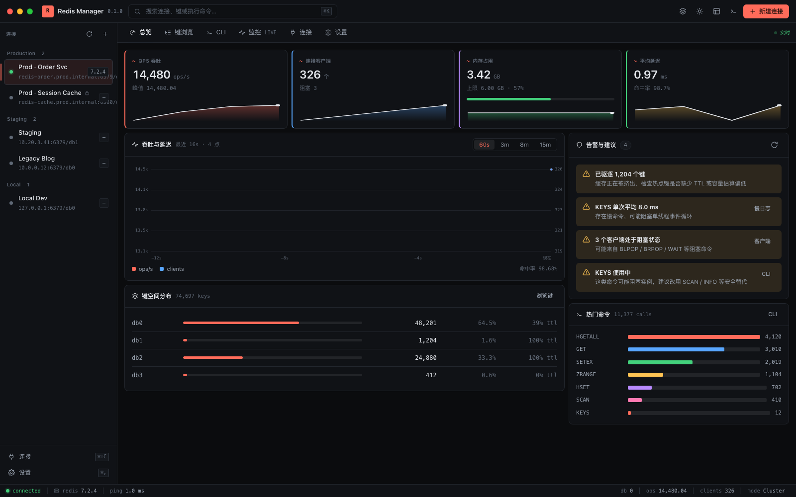
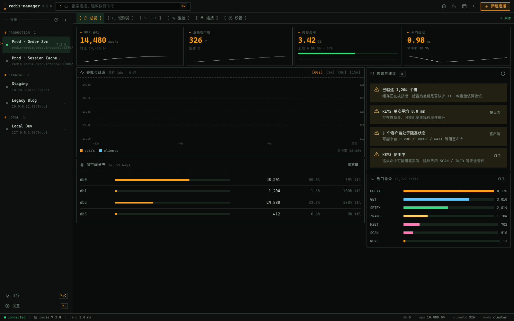
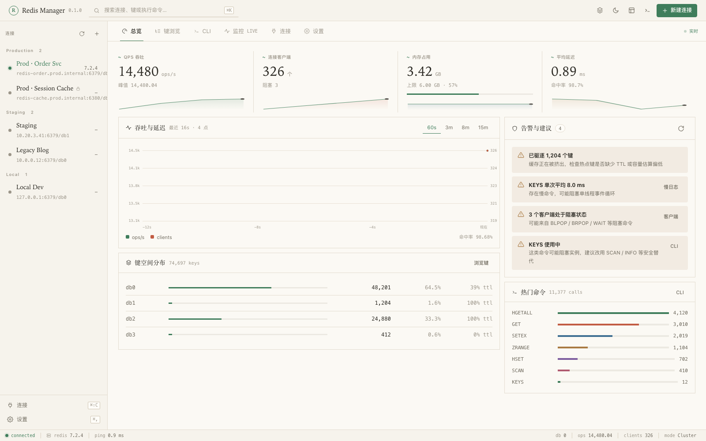
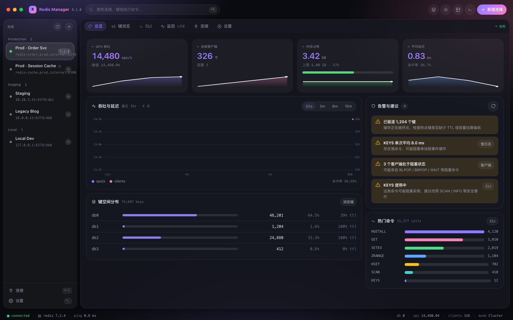

# 主题系统

Redis Manager 的前端只有**一套**页面与业务逻辑，视觉差异全部由**主题**提供。
四套主题共用同一个信息架构（连接栏 / 页签 / 内容 / 状态栏），但各自的排版、空间组织与装饰语汇不同。

| 主题 | 一句话 | 默认配色 | 截图 |
|---|---|---|---|
| **Console** | 数据工作台：深色高密度仪表盘、珊瑚点缀、等宽数字、⌘K 命令面板 | 深色（可选浅色） | [总览](screenshots/themes/console-dark-overview.png) · [键浏览](screenshots/themes/console-dark-browser.png) · [监控](screenshots/themes/console-dark-monitor.png) |
| **Terminal** | 终端极客：全等宽字体、琥珀荧光、`[ ]` 方框与 `█░` 进度条、0 圆角 | 深色（单配色） | [总览](screenshots/themes/terminal-dark-overview.png) · [键浏览](screenshots/themes/terminal-dark-browser.png) · [CLI](screenshots/themes/terminal-dark-cli.png) |
| **Craft** | 雅致工具：暖纸色、衬线标题、1px 细线、大留白、目录式导航 | 浅色（可选深色） | [总览](screenshots/themes/craft-light-overview.png) · [键浏览](screenshots/themes/craft-light-browser.png) · [深色 CLI](screenshots/themes/craft-dark-cli.png) |
| **Airy** | 轻盈玻璃：桌面壁纸、悬浮圆角窗口、毛玻璃侧栏、紫粉渐变 | 深色（可选浅色） | [总览](screenshots/themes/airy-dark-overview.png) · [键浏览](screenshots/themes/airy-dark-browser.png) |

[可点击的截图索引](screenshots/themes/index.html)






## 切换主题

- 顶栏右上角的 **层叠图标** → 主题菜单（含深浅色）；
- **设置 → 外观 · 主题**：带缩略图的完整选择器；
- 顶栏的 **太阳/月亮** 按钮切换当前主题支持的深浅色；
- 选择会写入 `localStorage`（`redis-manager.settings.v2`），下次启动自动恢复。

## 实现方式

```
src/
├── theme/
│   ├── themes.ts        主题清单（名称、是否支持深浅色、默认配色、缩略图色板）
│   └── settings.ts      设置存储：localStorage + data-theme / data-scheme 同步
├── styles/
│   ├── tokens.css       ① 主题 token 契约 + 四套主题的 token 定义
│   ├── base.css         reset / 排版 / 滚动条（全部读 token）
│   ├── components.css   ② 组件层：按钮、卡片、页签、表格、对话框……（只读 token）
│   ├── views.css        页面布局（总览网格、键浏览两栏、CLI 终端、设置）
│   └── themes.css       ③ 主题差异层：只放 token 表达不了的「构成性」差异
├── ui/                  壳层（顶栏/侧栏/页签/状态栏/命令面板/Toast）与通用小组件
├── views/               总览 / 键浏览 / CLI / 监控 / 连接 / 设置
└── core/                状态 store、Go 绑定封装、格式化、图标、SVG 图表
```

### ① token 契约

`tokens.css` 里的 `:root` 是**所有主题必须填满的全部变量**，分为几组：

- 排版：`--font-ui` `--font-display` `--font-mono` `--font-size` `--display-weight` `--label-transform` …
- 表面：`--bg` `--bg-panel` `--bg-raised` `--bg-input` `--bg-hover` `--bg-selected` `--bg-code` …
- 线条与文字：`--line` `--line-strong` `--fg` `--fg-2` `--fg-3`
- 语义色：`--accent` `--ok` `--warn` `--err` `--info`，以及六种数据类型的 `--type-string/hash/list/set/zset/stream`
- 图表系列：`--series-0 … --series-5`
- 几何：`--radius-xs … --radius-xl` `--card-pad` `--row-h` `--control-h` `--topbar-h` `--sidebar-w` `--content-pad`
- 层次：`--shadow-1/2/pop` `--glow` `--backdrop`

### ② 结构轴（structural axes）

有些差异不是颜色（方框标签、ASCII 进度条、胶囊页签），而是**构成**。它们也做成 token，
组件不需要 if/else，只靠 CSS 选择器读轴：

| 轴 | 取值 | 谁在用 |
|---|---|---|
| `--slot-datapill` | `pill` / `bracket` / `block` | Terminal 用 `[STRING]`，Console 用色块 |
| `--slot-bar` | `solid` / `ascii` | Terminal 的 `████░░░░` 进度条 |
| `--slot-tabs` | `underline` / `block` / `pill` | Terminal 页签是 `[ 总览 ]`，Airy 是胶囊 |
| `--slot-segmented` | `boxed` / `text` / `pill` | Craft 的分段控件是下划线文字 |
| `--slot-switch` | `toggle` / `checkbox` | Terminal 用 `[x]` |
| `--slot-sidebar` | `attached` / `floating` | Airy 的侧栏悬浮 |
| `--slot-window` | `flat` / `floating` | Airy 的整窗悬浮圆角 |
| `--slot-card` | `outlined` / `raised` / `glass` | 卡片层次 |
| `--slot-table` | `plain` / `ruled` / `zebra` | 表格行样式 |

### ③ 主题差异层

只有「构成性差异」才进 `themes.css`，例如：Terminal 的自绘 traffic light 隐藏 + `:command` 风格动作；
Craft 的 KPI 行由卡片变成编辑式分栏；Airy 的整窗背景渐变与弹层不透明化。
新增主题时**先填 token**，只有确实做不到时才写选择器覆盖。

## 新增一个主题

1. 在 `src/theme/themes.ts` 的 `THEMES` 里加一条元数据（`id`、`name`、`tagline`、`schemes`、`swatch`）；
2. 在 `tokens.css` 里加 `:root[data-theme="<id>"]` 与各 `[data-scheme]` 的 token 块；
3. 需要的话在 `themes.css` 里补少量构成性覆盖；
4. 设置页的主题选择器与顶栏菜单会自动出现新主题，缩略图由 `views/settings.ts` 的 `thumb()` 绘制。

## 截图

```bash
node scripts/shoot-themes.mjs          # 构建 + 起 vite preview + headless Chrome 截图
```

页面带 `?preview=1` 时会加载 `scripts/preview-mock.js` 的假数据，不需要 Redis。
