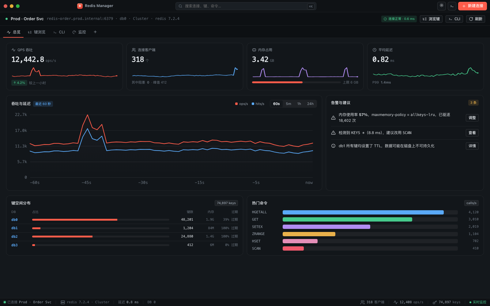
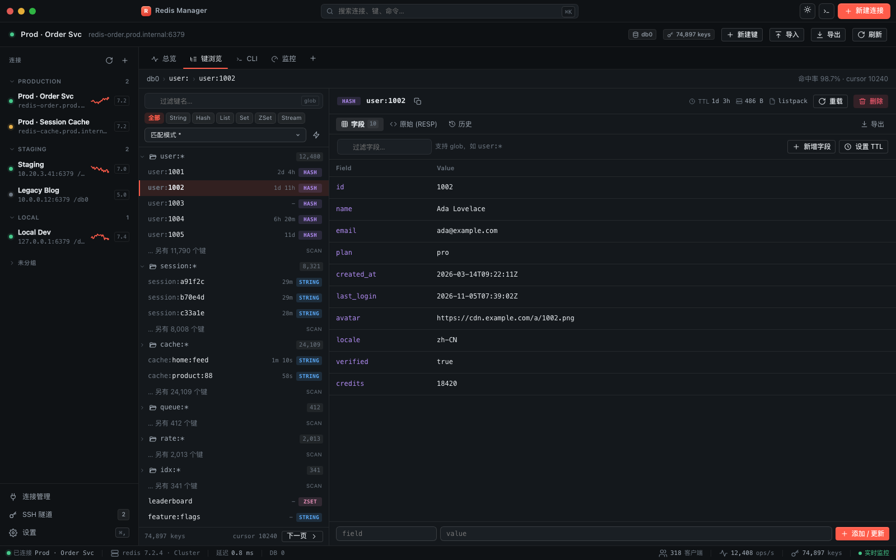
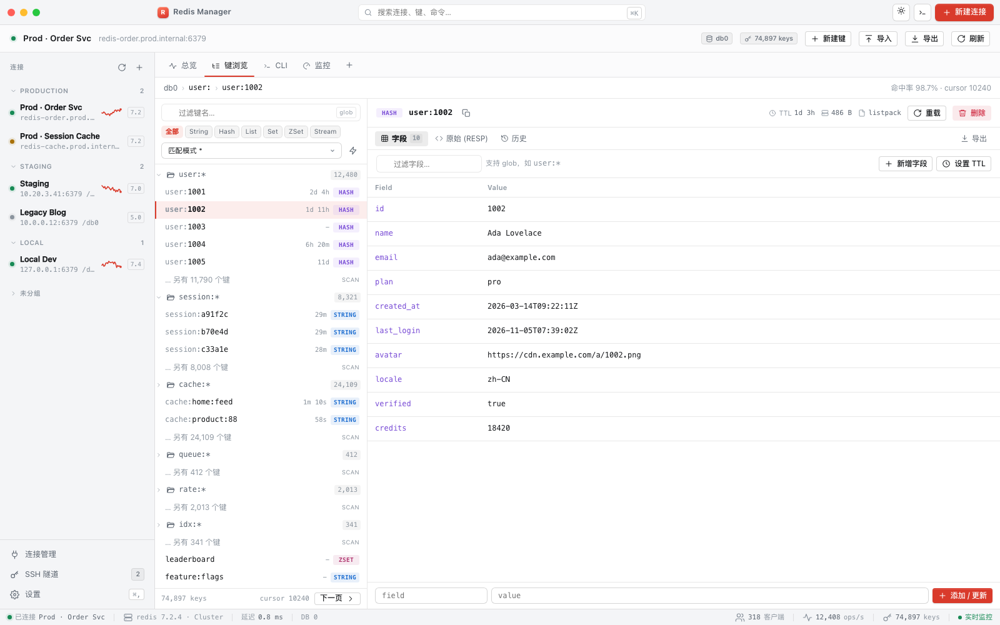
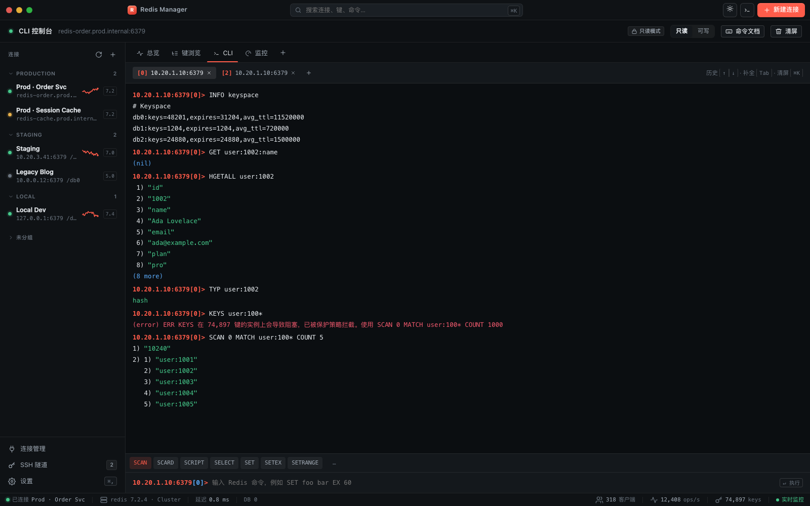
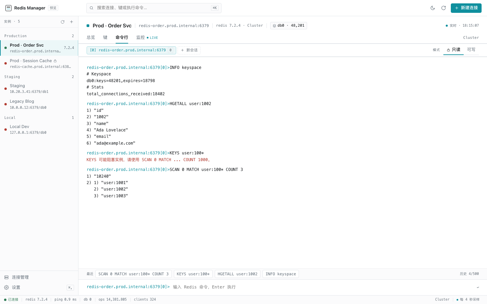
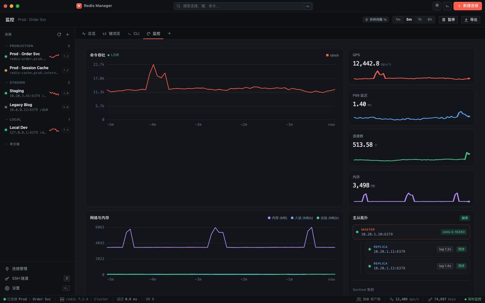
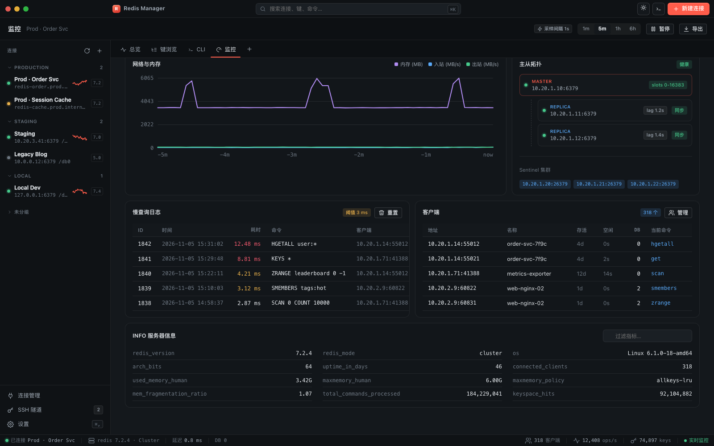
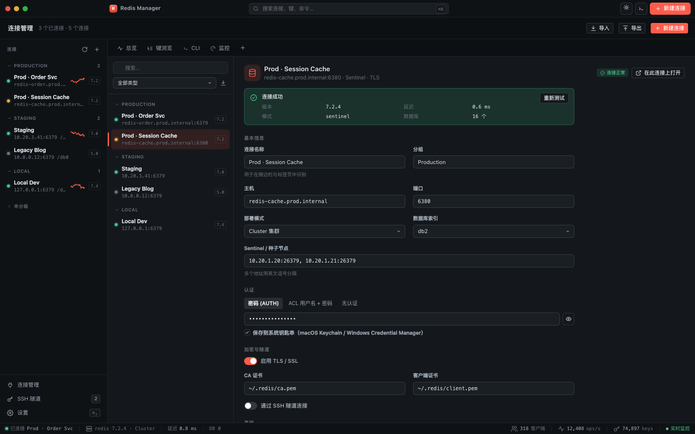
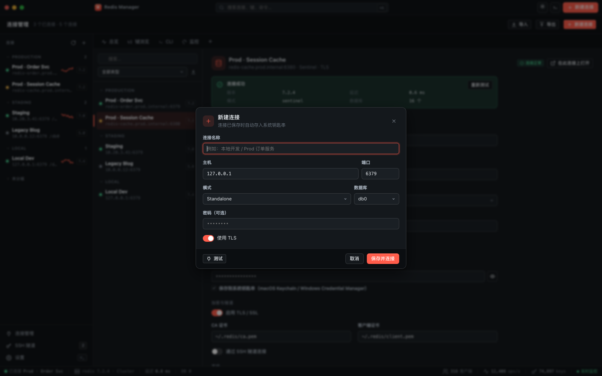
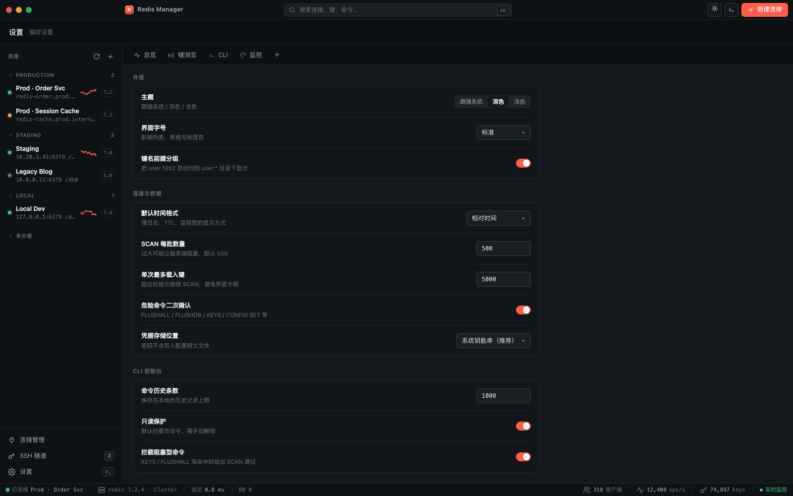

> **历史记录**：本文是重构前的 UI 原型说明，其中的截图与「主题 / 导航」描述已不代表现行界面；现行实现见 [设计系统](../DESIGN.md)。

# Redis Manager · UI 原型设计说明

> 目标：管理 Redis 连接的桌面软件。能创建/管理连接、浏览与编辑数据、读取服务器性能、在内置 CLI 中执行 Redis 命令。
> 技术方向：**Go + MyGo**。本文先把 UI 与交互定下来，再给出 Go 侧落地建议。
> 可交互原型：[`../prototype/index.html`](../prototype/index.html)；截图：[`screenshots/`](screenshots)。

---

## 1. 技术选型：MyGo 的两种界面形态

[MyGo](https://github.com/egoist/mygo) 是 pure-Go、无 cgo 的 Go 桌面框架（v0.7.x，Go 1.27+）。它的窗口可以是两种之一，同一个 App 可以混用：

| | A. Web 前端（WebView） | B. 原生 UI（`ui` 包） |
|---|---|---|
| 渲染 | 系统 WebView（WKWebView / WebKitGTK / WebView2） | MyGo 自己在 GPU 上绘制 |
| 前端技术 | HTML/CSS/TS + Vite，任意 Web 技术栈 | 纯 Go，无 HTML/JS |
| 与 Go 通信 | `mygo.Bind` 生成类型化 TS 客户端，可直接 `chan` 流式推送 | 视图就是 Go 函数，每帧按 state 重建 |
| 大列表/表格 | 浏览器原生能力，虚拟滚动容易 | 有 `List`/`Table`/`Tree`/`Outline` 等组件（含虚拟化） |
| 图表 | ECharts / uPlot / 自写 Canvas，生态最全 | `Chart` 组件（scale/axis/mark，可画线/柱/面积/环） |
| 富文本编辑、代码高亮 | CodeMirror / Monaco 直接可用 | 有 `CodeEditor`（Zed 风格，高亮/补全/多光标）和 `RichTextEditor` |
| 体积 / 启动 | 多一个 WebView 进程，内存高出几十 MB | 开窗即用，内存低 |
| 依赖 | Linux 需 WebKitGTK；Windows 需 WebView2 运行时 | Linux 只需 GTK3 |

**建议：选 A（Web 前端）**，理由：

1. Redis 管理器的核心界面是 **键值表格 + 大文本编辑器 + 实时图表 + 终端式 CLI**，这四样在 Web 生态里都有成熟、稳定、可直接嵌入的现成组件；
2. 数据量可能很大（几十万键、几十 KB 的 value），浏览器的 DOM 虚拟化与文本渲染比手写原生控件更省心；
3. 克隆仓库的开发模式已经固定：**Go 后端（redis 客户端 / 采样 / 连接存储）+ TS 前端（界面）**，Go 侧专心做网络与数据，界面迭代不用重编译；
4. MyGo 的 WebView 模式同样产出**单个几 MB 的 Go 二进制**，打包、签名、更新（Sparkle 式增量更新）都现成。

保留 B 作为后续优化点：如果某些窗口（比如只读的轻量监控浮窗、菜单栏小面板）希望“秒开、省内存”，可以用 `ui.View` 单独做一个原生窗口，与主窗口共用同一套 Go service（见 §7）。

> 注：本原型的 HTML/CSS 可以**几乎原样**搬进 MyGo 的 Vite 前端工程，再逐步替换成 React/Solid（可选）并把 mock 数据换成 `mygo.Bind` 的调用。

---

## 2. 信息架构

```
应用窗口
├─ 标题栏（自绘 traffic lights + 全局搜索 ⌘K + 主题切换 + CLI + 新建连接）
├─ 左侧连接栏（常驻）
│   ├─ 分组：Production / Staging / Local / 未分组
│   ├─ 连接项：状态点 · 名称 · host:port/db · 迷你 QPS 火花线 · 版本
│   └─ 底部：连接管理 / SSH 隧道 / 设置
├─ 主区域（按连接打开的标签页）
│   ├─ 总览 overview       – KPI、吞吐/延迟、告警建议、热门命令、键空间分布
│   ├─ 键浏览 browser      – 键树（前缀分组）+ 值编辑器（按类型分视图）
│   ├─ CLI console         – 命令输入、历史、补全、只读保护
│   └─ 监控 monitor        – 实时吞吐、内存/网络、主从拓扑、慢日志、客户端、INFO
├─ 全局页面：连接管理 connections、设置 settings
└─ 底部状态栏：连接状态 · 版本 · 延迟 · 当前 db · 客户端数 · OPS · 键数 · 实时监控
```

**导航原则**

- 左侧是“**哪个服务器**”，标签是“**这台服务器上的哪件事**”。切换连接不打断其他连接上已打开的标签；
- 标签可拖拽、可关闭（原型展示为带 × 的标签条），CLI 可以多开（同一连接开多个 db 会话）；
- 一切危险操作就地可见：TTL、内存、编码、只读/可写模式始终在视野内。

---

## 3. 视觉规范（Design tokens）

原型里全部落在 `css/app.css` 的 `:root` / `[data-theme]` 上，改一处全局生效。

- **色板**：品牌色用 Redis 的朱红系 `--accent: #ff5c4a`（深色）/ `#d93a2b`（浅色），不做大面积铺色，只用在“当前选中、主按钮、关键折线”；
  语义色：成功 `#46c98b`、警告 `#e9b14b`、危险 `#f0596d`、信息 `#5aa9f7`、Redis 数据类型的紫色 `#b18cf2`。
- **背景层级**：窗口 `--bg` → 侧栏 `--bg-sidebar` → 内容卡片 `--bg-chart` → 代码/终端 `--bg-code`。深色下用“越靠近用户越亮”的层级，靠 1px 低透明度描边分隔，不堆阴影。
- **字体**：界面 `-apple-system / PingFang SC / Segoe UI`；所有键名、value、命令、数值用等宽字体（SF Mono / JetBrains Mono），数字开启 `tnum` 等宽数字，避免跳动。
- **字号**：12–13px 为主，表格 12.5px，辅助信息 11px，KPI 数字 23px。中文界面里刻意保持较小的字号以贴近 IDE / 工具的密度。
- **圆角**：6px（控件）/ 8px（列表项、输入）/ 12px（卡片、对话框）。
- **数据类型徽标**：String 蓝、Hash 紫、List 绿、Set 黄、ZSet 粉、Stream 青，统一 `type-pill` 样式，列表和详情页共用同一套颜色，形成肌肉记忆。
- **主题**：深色为默认（开发者长时间使用），浅色一整套 token 同步提供，`prefers-color-scheme` 为“跟随系统”。

---

## 4. 各页面设计

### 4.1 总览 Overview



- **KPI 行**：QPS、连接客户端、内存占用（带 maxmemory 进度条）、平均延迟（附 P99）。每个 KPI 下方一条火花线，给出“趋势感”而不需要图表交互；
- **吞吐与延迟**：双序列折线，时间窗 60s / 5m / 1h / 24h 分段切换，hover 出十字线 + tooltip；
- **告警与建议**：把“值得知道的事”翻译成人话——内存策略与驱逐、`KEYS *` 慢调用、全量 TTL 的持久化风险，每条都带直接动作（调整 / 查看 / 详情）；
- **热门命令 & 键空间分布**：命令按调用占比条形展示（一眼看出谁在打 Redis），键空间按 db 展示键数 / 内存 / 过期比例。

设计取舍：总览不追求“列出全部 INFO”，只回答三个问题：**现在健康吗？谁在用？数据长什么样？**

### 4.2 键浏览 Key Browser




- **键树按前缀分组**：从 SCAN 结果里提取 `user:`、`session:`、`cache:` 前缀自动成组，折叠显示大数字（12,480），组内最多预取一批键，其余显示“另有 N 个键 → 继续 SCAN”。这是 Redis GUI 最大的性能陷阱，界面上明确告知“**我们只 SCAN，不发 KEYS**”；
- **顶部过滤条**：名称过滤（glob）+ 类型筛选 chips + 匹配模式；右侧闪电按钮才是“真的使用 KEYS（带二次确认）”的逃生口；
- **值编辑区**：
  - 头部一行：类型徽标、键名、复制、**TTL / 大小 / 编码**、重载、删除；
  - 视图标签随类型变化：String → 多行编辑器 + `JSON 格式化 / 转义 / 复制 / 保存`；Hash → 字段表格 + 行内编辑/删除，底部常驻“field + value → 添加/更新”；List → 索引表格，支持 L/R push；Set → 成员表格 + 搜索；ZSet → member / score 双列可排序；Stream → entry 表格 + 消费组面板；
  - 表格视图始终有“原始 (RESP)”切换，方便排查编码问题；
  - 编辑态在底部显示 `未保存` 圆点 + `⌘S 保存 / Esc 放弃`，避免误提交。

### 4.3 CLI 控制台




- 每个会话对应 `host:port[db]`，可多开（标签）；`SELECT` 后提示符里的 db 跟着变；
- **只读 / 可写** 分段开关：默认只读，写命令被拦截并提示如何解锁。对生产环境尤为重要；
- **补全**：输入时下方给出候选命令条（Tab 循环，Enter 执行），命令文档内联显示；
- **输出渲染**：RESP2/RESP3 编号列表按层级缩进；字符串绿、数字蓝、错误红；`(nil)`、`(integer)`、`(8 more)` 与 redis-cli 一致；
- **历史**：↑/↓ 翻历史，`⌘K` 清屏，历史条数可配置；
- **保护策略**：`KEYS *`、`FLUSHALL` 等阻塞型命令默认拦截，并给出等价的安全写法（`SCAN 0 MATCH ... COUNT 1000`）。原型里演示了这条错误提示。

### 4.4 监控 Monitor



向下滚动是慢查询、客户端列表与 INFO 指标：



- **实时曲线**：命令吞吐（主图）+ 4 个迷你 KPI（QPS / P99 / 连接数 / 内存）；下图为内存 + 入站/出站网络；
- **主从拓扑**：Master → Replica 的层级卡片，复制延迟、同步状态；Sentinel 列表；
- **慢查询日志 / 客户端列表**：表格化，耗时按阈值染色（>5ms 红、>3ms 黄）；客户端展示 addr / name / age / idle / db / 当前命令（对应 `CLIENT LIST`）；
- **INFO 服务器信息**：键值网格，顶部可过滤指标；点击某个指标可“固定到卡片”。

### 4.5 连接管理与连接编辑器



顶部“新建连接”弹窗为快速创建，保存后可进入上面的完整编辑器。



- 左侧二级列表：搜索 + 按部署类型筛选 + 导入；
- 右侧表单分组：**基本信息**（名称 / 分组 / 主机 / 端口 / 部署模式 Standalone·Sentinel·Cluster / db / 种子节点）、**认证**（AUTH 密码 / ACL 用户名+密码 / 无认证，默认存入系统钥匙串）、**加密与隧道**（TLS 的 CA 与客户端证书、SSH 隧道）、**高级**（超时、只读模式、颜色标记）；
- **连接测试**内联展示：版本、延迟、模式、db 数量——让用户保存前就有信心；
- 顶部对话框是“快速新建”（最常用字段），保存后可进入完整编辑器。

### 4.6 设置 Settings



分组设置：外观（主题/字号/键名前缀分组）、连接与数据（SCAN 批量、单次最大载入键、危险命令二次确认、凭据存储位置）、CLI（历史条数、只读保护、阻塞命令拦截）、关于（版本、构建、配置文件位置）。

---

## 5. 关键交互约定

| 场景 | 约定 |
|---|---|
| 全局搜索 `⌘K` | 统一入口：连接、键（跨连接）、命令、设置项，模糊匹配后回车直达 |
| 危险命令 | `FLUSHDB / FLUSHALL / CONFIG SET / KEYS / DEBUG / SCRIPT FLUSH` 等：默认拦截 + 二次确认，且确认框要求输入命令名 |
| 大 value | 超过 100 KB 的值默认折叠预览，点击“加载完整内容”，避免卡死；二进制内容显示 hex dump |
| 编辑冲突 | 保存时若 `WATCH`/版本已变，提示“该键已被其他客户端修改，是否覆盖？” |
| TTL 显示 | 永远显示相对时间（`1d 3h`），hover 显示绝对时间与毫秒 |
| 只读模式 | 连接级别开关；打开后所有写按钮置灰并带 tooltip，CLI 同样生效 |
| 加载状态 | 列表用骨架屏，长时间 SCAN 显示“已扫描 5,000 / 继续”，可随时中断 |
| 错误 | 连接断开时侧栏状态点变灰、状态栏显示重连倒计时，正在看的数据保留只读快照 |

---

## 6. 建议的 Go 代码结构

```
redis-manager/
├── main.go                    mygo.App 启动、窗口、菜单、快捷键
├── services/
│   ├── connections.go         连接 CRUD（~/.config 下加密存储 + 系统钥匙串存密码）
│   ├── pool.go                *redis.Client 池：按连接 ID 复用、健康检查、重连
│   ├── keys.go                SCAN 分页、前缀分组、TYPE/TTL/MEMORY USAGE/OBJECT ENCODING
│   ├── values.go              按类型的读取与编辑（hash/list/set/zset/stream）
│   ├── cli.go                 命令解析（shlex）、执行、RESP 渲染、保护策略
│   ├── monitor.go             INFO 采样（ticker → chan）、慢日志、客户端、主从
│   └── clihelp.go             命令元数据（名称/参数/简介），供补全与文档
├── frontend/                  Vite + TS（或 React/Solid），由 mygo 生成 typed client
│   ├── src/mygo.ts            自动生成
│   ├── src/pages/…            总览 / 键浏览 / CLI / 监控 / 连接 / 设置
│   └── css/app.css            本原型的设计 token 与样式
├── mygo.config.ts
└── go.mod
```

依赖建议：Redis 协议用成熟的 Go 客户端（如 `go-redis/v9`，支持 Cluster / Sentinel / TLS / ACL / RESP3 / pipeline），MyGo 只负责外壳与 IPC。

### Go service 与前端接口（示意，MyGo 会据此生成 TS 类型）

```go
type Conn struct {
    ID, Name, Group, Host string
    Port, DB              int
    Mode                  string // standalone | sentinel | cluster
    TLS                   bool
    ReadOnly              bool
    Color                 string
}

type KeyPage struct {
    Keys   []KeyMeta // Key, Type, TTL, Size, Encoding
    Cursor uint64
    Done   bool
}

type KeyMeta struct{ Key, Type, Encoding string; TTLms int64; Size int64 }

type Services struct{ /* 连接池 */ }

// ListConnections 返回所有已保存的连接（密码不返回）。
func (s *Services) ListConnections() ([]Conn, error)

// SaveConnection 保存连接；password 写入系统钥匙串。
func (s *Services) SaveConnection(c Conn, password string) error

// TestConnection 连接并返回 INFO 摘要，用于“测试连接”。
func (s *Services) TestConnection(c Conn, password string) (map[string]string, error)

// ScanKeys 用 SCAN 分页遍历键，pattern 为空表示全部。
func (s *Services) ScanKeys(connID string, db int, pattern string, cursor uint64, count int) (KeyPage, error)

// GetValue 读取一个键的值，按类型返回不同的结构。
func (s *Services) GetValue(connID, key string) (Value, error)

// SetField / DelField / PushList / AddMember … 按类型提供细粒度写操作
func (s *Services) HashSet(connID, key, field, val string) error

// ExecCLI 执行一条 CLI 命令，返回已渲染的行（含错误）。
func (s *Services) ExecCLI(connID string, db int, line string, readOnly bool) ([]CLILine, error)

// WatchInfo 以 chan 持续推送 INFO 采样，前端订阅即可画实时曲线。
func (s *Services) WatchInfo(ctx context.Context, connID string, intervalMs int) (<-chan Sample, error)

type Sample struct {
    AtMs        int64
    OpsPerSec   float64
    MemUsed     int64
    Clients     int
    NetIn, NetOut float64
    LatencyP99  float64
}
```

前端侧即：

```ts
const page = await Services.scanKeys(connId, 0, "user:*", 0, 500);
const value = await Services.getValue(connId, "user:1002");
Services.watchInfo(connId, 1000, (s) => pushSample(s)); // chan 流式
```

### 实现顺序建议

1. **外壳**：MyGo 窗口 + 自绘标题栏 + 侧栏 + 标签页 + 设计 token（直接复用本原型 CSS）；
2. **连接管理**：CRUD + 钥匙串 + `PING`/`INFO` 测试，打通 Go↔TS 绑定；
3. **键浏览**：SCAN 分页 + 前缀分组 + 各类型的值视图（先只读）；
4. **值编辑**：按类型的写操作 + TTL 设置 + 删除；
5. **CLI**：执行 + 输出渲染 + 历史 + 只读保护 + 补全；
6. **监控**：`WatchInfo` 流 → 图表（uPlot 轻量、ECharts 功能全）；
7. **打磨**：⌘K 全局搜索、导入导出、克隆连接、SSH 隧道、Sparkle 式自动更新。

---

## 7. 安全与性能要点

- **凭据**：配置文件只存非敏感字段；密码走系统钥匙串（MyGo 提供 `Secrets` / 系统凭据相关 API），并在设置里可切换为“每次询问”；
- **绝不 `KEYS *`**：键盘浏览一律 `SCAN` + `MATCH` + `COUNT`，并设上限（默认 5,000 键/次）；`KEYS` 仅在用户显式点击闪电按钮时执行；
- **大键保护**：`STRLEN`/`HLEN`/`MEMORY USAGE` 先判断体量，超限不整段加载；
- **只读默认**：生产连接默认只读；写命令需要显式解锁；
- **MONITOR / SLOWLOG**：`MONITOR` 在 UI 上等价于“实时命令流”，务必提示性能影响，默认不开启；
- **采样频率**：INFO 采样默认 1–2s，后台不可见窗口自动降频（`mygo.App` 的窗口事件里处理）。

---

## 8. 下一步

- 评审本原型（配色、信息密度、键浏览分组方式、CLI 只读默认是否符合预期）；
- 确认后可以直接用 `go run github.com/egoist/mygo/cmd/mygo@latest init` 建工程，把 `prototype/css` 与 `prototype/js/views.js` 的结构迁进 Vite 前端，先把 §6 的 Go service 用 mock 数据跑通绑定，再逐个接真实 Redis。
